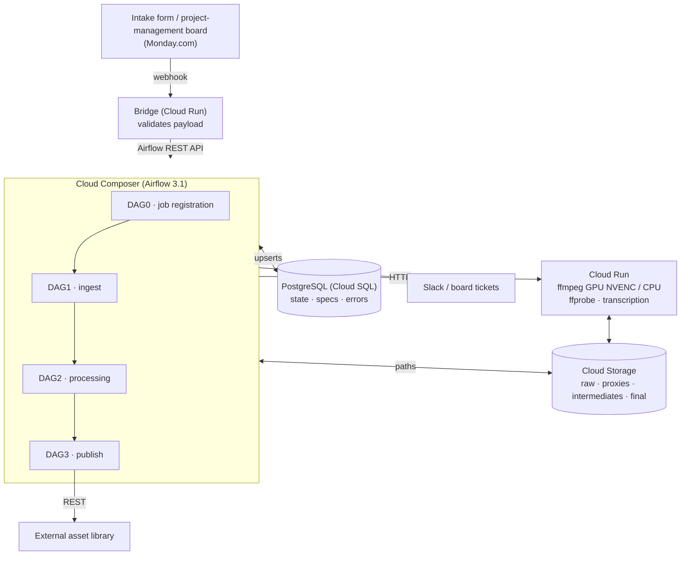
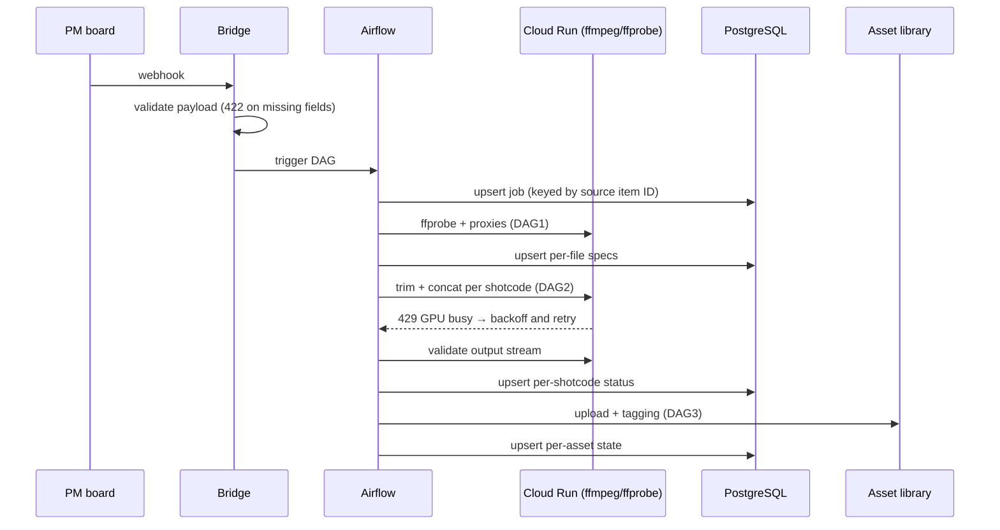

# Video Processing Orchestrator — Technical Overview

> Sanitized version: no secrets, resource IDs, bucket names, client data, or business metrics.

## 1. Purpose

A pipeline that takes raw footage, validates it technically, trims and assembles it from an editorial timeline (XML), and publishes the deliverables to an external asset library. Every job carries a unique code that follows it end to end: database, storage, logs, and the project-management board.

## 2. Architecture

### Job sequence

| Component | Role |
|---|---|
| **Cloud Composer / Airflow 3.1** | Orchestration: TaskFlow API, dynamic task mapping, pools, trigger rules |
| **Cloud Run** | Per-request ephemeral compute: webhook bridge, GPU ffmpeg (NVIDIA L4, NVENC), CPU ffmpeg (libx264/libx265), ffprobe + thumbnails + stream validation, transcription |
| **GCS** | Media storage per stage; tasks pass *paths* between each other, never bytes |
| **PostgreSQL (Cloud SQL)** | Source of truth for state: job, per-file technical specs, per-shotcode status, pipeline errors |
| **External APIs** | Project-management board (GraphQL), asset library (REST), Slack (alerts) |

## 3. Job flow

1. **Intake** — the webhook reaches the bridge; the payload is validated (422 on missing fields) and the matching DAG is triggered.
2. **Ingest (DAG1)** — files are copied to GCS, specs are extracted with ffprobe, files that need a proxy are detected (ProRes, bitrate above the player limit), and proxies are encoded on GPU.
3. **Processing (DAG2)** — the XML timeline is validated against the real files, IQC runs per file, segments are trimmed and concatenated per shotcode. GPU/CPU routing depends on codec and resolution.
4. **Pre-delivery validation** — ffprobe on the output (codec, resolution, fps, duration, audio stream) before it is marked deliverable.
5. **Publish (DAG3)** — upload to the external library and tagging, with per-asset state persisted.

## 4. Concurrency and resource control

- **Separate Airflow pools** for GPU, CPU, and external uploads, so services with limited concurrency are never oversubscribed.
- **`max_active_runs`** per DAG to bound simultaneous jobs.
- **Absolute `priority_weight`**: concat tasks (closer to delivery) run ahead of trim tasks.
- **Configurable GPU/CPU routing** per content type (HEVC, 4K) through Airflow Variables, with no redeploy.

## 5. Retries

| Layer | Strategy |
|---|---|
| Airflow tasks | Default `retries` + `retry_delay`; capped exponential backoff on external-API tasks |
| Mapped tasks | Fixed `retry_delay` (exponential backoff is avoided on `MappedOperator` because of behavior observed in the Airflow version in use) |
| HTTP client to Cloud Run | Selective retry: **429** (GPU busy, concurrency=1) with a long backoff and its own counter; **502/503** (instance recycling) with a short backoff. Other 4xx and timeouts are **not** retried — the request already has a long timeout, and retrying would duplicate heavy work |
| Classified errors | An alert manager categorizes the exception, persists it to the errors table, and notifies (Slack / ticket) |

## 6. Idempotency

The pipeline assumes **any task can run more than once** (retry, manual clear, reprocess):

- **Upserts** with `INSERT … ON CONFLICT` on natural keys: (job), (job, file), (job, shotcode), (job, asset). A reprocess bumps a round counter instead of duplicating rows.
- **Idempotent job registration** keyed by the source item ID: if it already has a code, that code is reused.
- **Absolute counters** (recomputed, not incremented) so a retry never inflates totals.
- **Storage side effects**: if the proxy already exists in GCS (e.g. a retry after a timeout), the re-encode is skipped; file moves tolerate a second pass.
- **Events to external systems** are keyed by `dag_run_id` so the receiver can deduplicate.

## 7. Validations

- **Input**: webhook schema at the bridge; XML validation (format, known shotcodes, timecodes within the file duration).
- **Technical**: per-file specs (codec, fps, resolution, bitrate) and the IQC / proxy decision.
- **Output**: stream validation of the output before delivery; internal proxies are validated with their own rules.
- **Explicit per-shotcode states** (`pending`, `completed`, `missing`, `wrong`, `ignored`) so no failure stays silent.

## 8. CI/CD

> **Status:** Designed and implemented the CI/CD (dry-run, approval gate, WIF); activation depended on infra provisioning owned by the IT team. Deploys are manual today.

**CI (GitHub Actions)** — on every PR and on `main`; it only verifies, never deploys:
- pytest unit tests in an environment that matches the Composer Python/Airflow version.
- **DAG import check** on the merged bucket layout (DAGs + plugins), catching import errors before deploy.
- Hygiene guards (e.g. failing on deprecated CLIs in scripts).

**CD (GitHub Actions)** — manual workflows (`workflow_dispatch`) with:
- **Dry-run** by default, printing the plan; **apply** behind a protected-environment approval.
- Ordered Composer sync (**plugins before DAGs**) and a post-sync bucket check against the repo (reports missing or extra files).
- Cloud Run build and deploy with a dedicated **rollback** workflow.
- Authentication via Workload Identity Federation (no service-account keys).

**Deploy rule**: a change that touches DAG + plugin + service ships together; a partial deploy counts as broken.

## 9. Observability

- Pipeline errors table with task, category, and message per job.
- Slack alerts and board tickets for actionable errors.
- Logs correlated by job code across Airflow and Cloud Run.

## 10. Design decisions

See [decisions.md](decisions.md).
